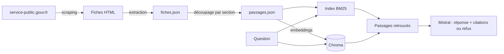

# Assistant RAG – Droit du travail

Assistant qui répond aux questions courantes des salariés du secteur privé (période d'essai, congés, rupture du contrat, temps de travail…) **uniquement à partir des fiches pratiques de [service-public.gouv.fr](https://www.service-public.gouv.fr)**. Chaque réponse cite ses sources et leur date de vérification. Si l'information n'est pas dans le corpus, l'assistant le dit au lieu d'inventer.

> ⚠️ **Information générale uniquement.** Cet assistant ne constitue pas un conseil juridique. Pour une situation précise, consultez un professionnel du droit, votre convention collective ou l'inspection du travail.

**Statut :** version 1 (MVP). Corpus restreint, évaluation sur un premier jeu de questions. Voir [Limites](#limites) et [Pistes d'amélioration](#pistes-damélioration).

---

## Sommaire
- [Pourquoi ce projet](#pourquoi-ce-projet)
- [Fonctionnement](#fonctionnement)
- [Données et licence](#données-et-licence)
- [Structure du projet](#structure-du-projet)
- [Installation](#installation)
- [Utilisation](#utilisation)
- [Évaluation](#évaluation)
- [Résultats](#résultats)
- [Limites](#limites)
- [Pistes d'amélioration](#pistes-damélioration)
- [Références](#références)

---

## Pourquoi ce projet
Un LLM seul répond avec ce qu'il a mémorisé : ses connaissances peuvent être datées, il peut halluciner, et il ne cite pas ses sources. Le **RAG** (*Retrieval-Augmented Generation*) lui fournit, au moment de la question, les passages de documents qui contiennent la réponse.

Le droit du travail est un bon terrain d'essai : les règles sont précises, elles changent, et une réponse fausse peut avoir des conséquences réelles. L'objectif n'est pas seulement de construire un assistant, mais de **mesurer** sa qualité : la bonne fiche est-elle retrouvée ? La réponse reste-t-elle fidèle aux sources ? L'assistant refuse-t-il quand il ne sait pas ?

## Fonctionnement
Le système suit l'architecture « Advanced RAG » (Gao et al., 2023) : une chaîne linéaire, améliorée par un découpage structuré et des métadonnées.



1. **Collecte** : scraping des fiches du thème « Travail – Formation » (secteur privé), avec cache local des pages HTML.
2. **Extraction** : titre, sections, date « Vérifié le » et URL de chaque fiche, avec contrôles qualité (fiches sans titre, sans date ou sans section).
3. **Découpage** : un passage par section. Le chemin de titres est ajouté en tête de chaque passage (« Fiche > Section ») pour qu'il se comprenne seul.
4. **Recherche** : deux méthodes comparées.
   - **BM25** (recherche lexicale, `rank-bm25`) ;
   - **recherche dense** (embeddings `sentence-transformers` stockés dans Chroma).
5. **Génération** : Mistral reçoit la question et les passages retenus. Le prompt impose de répondre uniquement à partir des extraits, de citer les sources et de refuser si l'information est absente. La sortie est validée avec Pydantic.

## Données et licence
- **Source** : fiches pratiques de Service-Public.gouv.fr, éditées par la DILA (Direction de l'information légale et administrative).
- **Licence** : contenu réutilisable sous Licence Ouverte / Etalab 2.0, sous réserve de **mentionner la source et la date de mise à jour**. Chaque réponse affiche donc l'URL et la date « Vérifié le » de la fiche citée.
- **Collecte responsable** : le fichier `robots.txt` du site n'interdit pas le chemin `/particuliers/vosdroits/` (consulté en octobre 2026). Le scraper s'identifie par un User-Agent explicite, attend entre deux requêtes et garde une copie locale des pages pour ne les télécharger qu'une fois.
- **Périmètre de la version 1** : environ _[N à compléter]_ fiches du secteur privé, collectées le _[date à compléter]_.

*Source : Service-Public.gouv.fr / DILA – [Licence Ouverte / Etalab 2.0](https://www.etalab.gouv.fr/licence-ouverte-open-licence).*

## Structure du projet
```
rag-droit-du-travail/
├── data/
│   ├── raw/html/            # pages téléchargées (non versionnées)
│   └── processed/
│       ├── fiches.json      # fiches extraites
│       └── passages.json    # passages découpés
├── eval/
│   ├── questions.csv        # jeu d'évaluation
│   └── resultats/           # résultats des expériences
├── src/
│   ├── collecte.py          # scraping
│   ├── extraction.py        # HTML → fiches structurées
│   ├── controle.py          # contrôles qualité
│   ├── decoupage.py         # fiches → passages
│   ├── recherche.py         # BM25 et recherche dense
│   ├── generation.py        # prompt + Mistral + Pydantic
│   └── evaluation.py        # Recall@k, MRR
├── tests/
├── requirements.txt
└── README.md
```

## Installation
```bash
git clone https://github.com/<ton-compte>/rag-droit-du-travail.git
cd rag-droit-du-travail
python -m venv .venv
source .venv/bin/activate          # Windows : .venv\Scripts\activate
pip install -r requirements.txt
```

Créer un fichier `.env` à la racine (il n'est jamais versionné) :
```
MISTRAL_API_KEY=ta_cle_api
```

## Utilisation
```bash
python src/collecte.py        # 1. télécharge les fiches
python src/extraction.py      # 2. extrait titre, sections, date
python src/decoupage.py       # 3. crée les passages
python src/evaluation.py      # 4. mesure BM25 et recherche dense
python src/generation.py "Mon employeur peut-il rompre ma période d'essai ?"
```
_Adapter les commandes aux noms réels des scripts._

## Évaluation
**Jeu de questions** (`eval/questions.csv`) : _[N à compléter]_ questions rédigées comme un salarié les poserait, **sans reprendre les mots des fiches** (pour ne pas avantager artificiellement BM25). Chaque question est associée à la fiche et à la section qui y répondent.

| Type de question | Nombre |
| --- | --- |
| Simple (une fiche répond) | _[à compléter]_ |
| Plusieurs fiches nécessaires | _[à compléter]_ |
| Vague ou mal formulée | _[à compléter]_ |
| Sans réponse dans le corpus | _[à compléter]_ |

**Métriques**
- **Recall@5** : part des questions dont le bon passage figure parmi les 5 premiers résultats.
- **MRR** (*Mean Reciprocal Rank*) : moyenne de 1/rang du premier bon passage (1 s'il est premier, 0,5 s'il est deuxième, 0 s'il est absent).
- **Refus corrects** : part des questions sans réponse pour lesquelles l'assistant refuse bien de répondre.

## Résultats
_À compléter avec les vrais chiffres. Ne pas arrondir à son avantage._

| Méthode de recherche | Recall@5 | MRR |
| --- | --- | --- |
| BM25 | _x_ | _x_ |
| Embeddings (`nom-du-modèle`) | _x_ | _x_ |

| Génération | Résultat |
| --- | --- |
| Refus corrects (questions sans réponse) | _x / N_ |
| Refus à tort (questions avec réponse) | _x / N_ |

**Ce qu'on en retient** : _[2 ou 3 phrases d'interprétation : quelle méthode gagne, sur quels types de questions, et pourquoi selon toi.]_

**Exemple de réponse**
> **Question** : _[question]_
> **Réponse** : _[réponse générée]_
> **Source** : _[titre de la fiche]_, vérifiée le _[date]_ – _[URL]_

## Limites
_Chaque limite : constat chiffré, cause, piste. À compléter après l'analyse des erreurs._

1. **Une seule recherche par question.** Les questions qui demandent plusieurs fiches obtiennent un Recall@5 de _x %_, contre _y %_ pour les questions simples. *Piste* : décomposer la question en sous-questions.
2. **Pas de mémoire de conversation.** Une question de suivi (« Et pour un CDD ? ») n'est pas comprise seule. *Piste* : réécrire la question à partir de l'historique avant la recherche.
3. **Situations dépendant de la convention collective.** Les fiches y renvoient souvent, mais les conventions ne font pas partie du corpus. L'assistant le signale sans pouvoir donner la règle exacte.
4. **Données récupérées par scraping.** Un changement de structure du site casserait l'extraction ; les contrôles qualité permettent de le détecter. _[x fiches]_ présentaient des sections manquantes ou du texte parasite.
5. **Petit jeu d'évaluation.** Avec _N_ questions, une question pèse _100/N_ points : les écarts faibles entre méthodes ne sont pas significatifs.

**Hors périmètre** : secteur public, situations individuelles complexes, conseil juridique.

## Pistes d'amélioration
- [ ] Recherche **hybride** (BM25 + embeddings, fusion par Reciprocal Rank Fusion)
- [ ] **Reranking** avec un cross-encoder
- [ ] Jeu d'évaluation élargi à 100 questions ou plus, avec intervalles de confiance
- [ ] Évaluation de la **fidélité** des réponses (juge LLM vérifié à la main)
- [ ] Extension **agentique** : décomposition des questions, questions de clarification
- [ ] Comparaison de LLM de tailles différentes : qualité, coût, latence
- [ ] Interface Streamlit, Docker et intégration continue (GitHub Actions)

## Références
- Lewis et al. (2020), [Retrieval-Augmented Generation for Knowledge-Intensive NLP Tasks](https://arxiv.org/abs/2005.11401)
- Gao et al. (2023), [Retrieval-Augmented Generation for Large Language Models: A Survey](https://arxiv.org/abs/2312.10997)
- Robertson et Zaragoza (2009), [The Probabilistic Relevance Framework: BM25 and Beyond](https://staff.city.ac.uk/~sbrp622/papers/foundations_bm25_review.pdf)
- Reimers et Gurevych (2019), [Sentence-BERT](https://arxiv.org/abs/1908.10084)
- Thakur et al. (2021), [BEIR: A Heterogeneous Benchmark for Zero-shot Evaluation of Information Retrieval Models](https://arxiv.org/abs/2104.08663)
- Liu et al. (2023), [Lost in the Middle: How Language Models Use Long Contexts](https://arxiv.org/abs/2307.03172)

## Auteur
**Mouhamadou Falilou KANDJI**, étudiant en Master 2 Science et Ingénierie des Données, Aix-Marseille Université.
[LinkedIn](https://linkedin.com/in/mouhamadou-falilou-kandji)